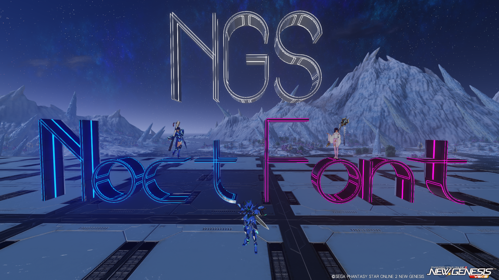

# NGS Noct

PSO2NGSのクリエイティブスペースで、ノクト系BPを組み合わせて作った文字をベースとするフォントです。



## フォント

等幅とプロポーショナルの2種類を軸に、低背版とBoldを用意しています。

| 名称 | 用途 |
| --- | --- |
| NGS Noct M | 等幅 |
| NGS Noct P | プロポーショナル |
| NGS Noct MF | 等幅・低背 |
| NGS Noct PF | プロポーショナル・低背 |

各書体にはRegularとBoldがあります。MF/PFは専用の `g/p/q` を使い、フォントの垂直メトリクスを通常版よりY座標2単位（400 units）低くしています。MFはMと同じ500-unit等幅です。

## 試し書き・ダウンロード

- [見本ページ](site/index.html) で書体・太さ・文字サイズを切り替えて試し書きできます。
- [`fonts/NGSNoct.ttc`](fonts/NGSNoct.ttc) は8書体をまとめたTrueType Collectionです。
- `fonts/` には個別のTTFとWOFF2もあります。TTFはインストール用、WOFF2はWeb用です。
- 収録文字は空白を含む108字です。

## SVGの構成

正本となる1字ずつのSVGは [`src/charsvg/`](src/charsvg/) の各サブディレクトリに配置しています。

- `digits/`: 数字（0〜9）
- `uppercase/`: 大文字（A〜Z）
- `lowercase_m/`: 等幅小文字（M用）
- `lowercase_p/`: プロポーショナル小文字（P用）
- `lowercase_mf/`: 等幅低背用小文字（MF用の `g`, `p`, `q`）
- `lowercase_pf/`: プロポーショナル低背用小文字（PF用の `g`, `p`, `q`）
- `symbols/`: 記号類

## ビルド

Windowsでは [`build_fonts.bat`](build_fonts.bat) を実行すると、フォントとTTCを生成し、見本ページ用のWOFF2を同期します。Pythonから実行する場合:

```powershell
python -m pip install -r tools/requirements-fonts.txt
python tools/build_fonts.py --variant both --glyph-dir src/charsvg --output-dir fonts
```

生成手順やリリース方法は [`docs/FONT_BUILD.md`](docs/FONT_BUILD.md)、収録字形の確認状況は [`docs/GLYPH_AUDIT.md`](docs/GLYPH_AUDIT.md) を参照してください。draw.io原稿は [`src/`](src/) にあります。
